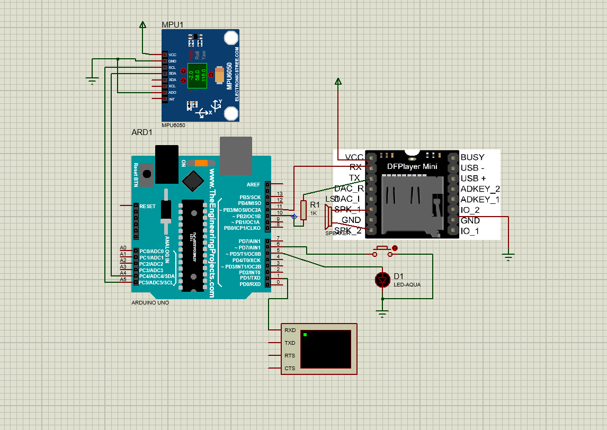

# Najiana — Smart Sleepwalking Detector

> An Arduino-based wearable wristband that detects sleepwalking episodes and gently wakes the user with progressive sound and vibration.

## Overview

**Najiana** (from Persian: *ناجی* = savior + *آنا* = guardian) is a low-cost wearable designed to protect sleepwalkers from injury. Using an MPU6050 accelerometer, it distinguishes real sleepwalking motion (sustained >10 seconds) from normal sleep movements (<5 seconds), then progressively activates a buzzer and vibration motor.

- **Target users:** Children and adults with parasomnia (sleepwalking)
- **Cost:** ~2.5M Toman (~$40 USD) — far cheaper than smartwatch alternatives
- **Competition:** Smartwatches (>5M Toman) or human supervision

## Features

- Motion detection via MPU6050 high-pass filter + interrupt
- 10-motion counter with 10-second auto-reset (filters false positives)
- Progressive 3-stage wake-up (30% → 70% → 100% PWM)
- Manual reset button for immediate stop
- Low power consumption (<50mW in standby)
- Rechargeable Li-ion battery (~8 hours runtime)

## Hardware

| Component | Qty | Approx. Price (Toman) |
|-----------|-----|----------------------|
| Arduino Nano | 1 | 390,000 |
| MPU6050 Gyroscope Module | 1 | 480,000 |
| Battery Charging Module | 1 | 168,000 |
| Mini DFPlayer | 1 | 204,000 |
| Micro SD Card | 1 | 700,000 |
| Li-ion Battery | 1 | 399,000 |
| 8Ω Speaker | 1 | 36,000 |
| Coin Vibration Motor | 1 | 50,000 |
| **Total** | | **≈ 2,427,000** |

## Wiring Diagram

| Arduino Pin | Connects To |
|-------------|-------------|
| A4 (SDA) | MPU6050 SDA |
| A5 (SCL) | MPU6050 SCL |
| D2 | MPU6050 INT |
| D5 | Buzzer / LED |
| D6 | Reset button (INPUT_PULLUP) |
| D10 | DFPlayer RX (via 1kΩ) |
| D11 | DFPlayer TX (via 1kΩ) |

## Scientific Basis

Two conditions must be met to trigger the alarm:

1. **Abnormal motion:** `|θ − θ₀| > θ_th` — deviation angle from vertical, calculated as  
   `θ = arctan(a_y / a_z) × 180/π`

2. **Time threshold:** `Δt_move > T_th` (10s)

Progressive wake-up intensity:

I(t) = { 0% if Δt < 10s

{ 30% PWM if 10s ≤ Δt < 15s

{ 70% PWM if 15s ≤ Δt < 20s

{ 100% PWM if Δt ≥ 20s

Full derivation: [`docs/scientific-assumptions.docx`](docs/scientific-assumptions.docx)
Code and Algorithm: []

## Team

- Hannah Kooshkbaghi
- Melina Zahedi Avval

## Achievements

- **Selected Project** — 5th Farhikhtegan Junior Festival, National level, 2025
- **Selected Project** — 12th Khwarizmi Junior Festival, Regional Level, 2025

## License

MIT License — see [LICENSE](LICENSE)

## Acknowledgments

Thanks to our dear school for supporting this project.
